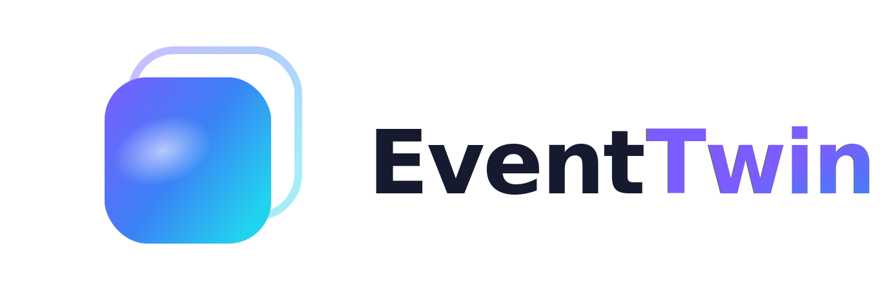
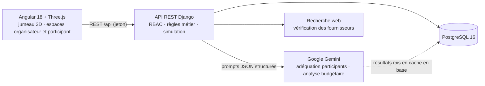
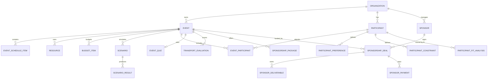

<div align="center">



# EventTwin

**Le jumeau numérique 3D prédictif des organisateurs d'événements.**
Simulez un événement avant qu'il n'ait lieu, repérez les risques et décidez avec l'IA avant d'engager votre budget.


[Démarrage rapide](#-démarrage-rapide--5-minutes) · [Comptes de démo](#-comptes-de-démo) · [Visite guidée](#-visite-guidée) · [Architecture](#-architecture) · [Prompts utilisés](docs/PROMPTS.md)

</div>

---

## 👥 Équipe

| | Membre | Contributions principales |
|:-:|---|---|
| 🧭 | **Mohamed Aziz Maatoug** | Architecture et mise en place Docker, module événements, jumeau numérique 3D, adéquation IA participant ↔ événement |
| 🔐 | **Chaima Naanaa** | Sécurité et RBAC, authentification par jeton, quiz, analyse budgétaire IA |
| 🙋 | **Feriel Ammar** | Module participant (espace, profil, onboarding, e-mails), modèle utilisateur, design front-office |
| 🤝 | **Ons Ghariani** | Module sponsors (packages, pipeline de deals, livrables, paiements, portail sponsor) |

---

## 🚀 Démarrage rapide (≈ 5 minutes)

> **Seul [Docker Desktop](https://www.docker.com/products/docker-desktop/) est nécessaire.** Node.js est facultatif (voir l'étape 3).
> Toutes les commandes se lancent depuis la **racine du dépôt**, dans PowerShell, un terminal macOS/Linux ou Windows Terminal.

### 1 · Démarrer la base de données et l'API

```bash
docker compose up --build -d
```

La première construction prend quelques minutes. Les migrations de la base s'exécutent automatiquement au démarrage de l'API.
Vérification : <http://localhost:8000/api/>. Une réponse JSON `401`/`403` est normale, car vous n'êtes pas encore connecté.

### 2 · Charger les données de démo et créer votre compte administrateur

```bash
docker compose exec api python manage.py loaddata fixtures/demo_snapshot.json
docker compose exec -e DJANGO_SUPERUSER_PASSWORD=EventWin2026 api python manage.py createsuperuser --noinput --username admin --email admin@eventwin.local
```

L'**instantané** charge 6 événements, 12 participants aux profils complets, 22 inscriptions, un budget, un pipeline de sponsoring
et **25 analyses IA déjà calculées avec Gemini**. Vous pouvez explorer les résultats de l'IA sans aucune clé API.

<details>
<summary>Variante : générer des données de démo neuves au lieu de l'instantané</summary>

```bash
docker compose exec api python manage.py seed_demo
```

Cette commande crée les mêmes comptes, événements et sponsors à partir du code, mais **sans** les analyses IA précalculées.
Vous pouvez ensuite les lancer depuis l'interface si une clé Gemini est configurée (voir [Optionnel : activer l'IA en direct](#-optionnel--activer-lia-en-direct)).
`seed_demo --reset` supprime puis recrée les données de démo. Utilisez l'une ou l'autre méthode, pas les deux.

</details>

### 3 · Lancer l'interface web

**Option A : avec Node.js 20+ installé** (la plus rapide)

```bash
npm install --prefix frontend
npm start
```

**Option B : sans Node.js, avec Docker uniquement** (à coller dans **PowerShell**, ou dans un terminal macOS/Linux)

```bash
docker run --rm -it -p 4200:4200 --add-host=host.docker.internal:host-gateway -v "${PWD}/frontend:/app" -v eventwin_node_modules:/app/node_modules -w /app node:20 sh -c "npm ci && sed -e 's#localhost:8000#host.docker.internal:8000#' -e 's#true#false#' proxy.conf.json > /tmp/proxy.json && npx ng serve --host 0.0.0.0 --proxy-config /tmp/proxy.json"
```

Cette commande reprend la configuration de proxy du projet et la redirige vers le conteneur de l'API. Le dépôt lui-même n'est pas modifié.
Le premier lancement installe les dépendances (≈ 3 min) ; les suivants sont beaucoup plus rapides.

### 4 · Ouvrir l'application

👉 **<http://localhost:4200>**, puis connectez-vous avec l'un des comptes ci-dessous.

---

## 🔑 Comptes de démo

Une seule page de connexion pour tous les rôles : le serveur détermine le rôle et l'application redirige vers l'espace correspondant.

| Rôle | E-mail | Mot de passe | Arrive sur |
|---|---|---|---|
| 👑 **Super-administrateur** | `admin@eventwin.local` | `EventWin2026` | Jumeau 3D + tous les modules + gestion des équipes |
| 🧭 **Organisateur** | `organisateur@demo.eventwin.local` | `Demo1234!` | Jumeau numérique 3D de ses événements |
| 🙋 **Participant** | `camille.durand@demo.eventwin.local` | `Demo1234!` | Espace participant (profil, événements à rejoindre) |

<details>
<summary>Les 11 autres comptes participants (mot de passe <code>Demo1234!</code>)</summary>

`mehdi.benali` · `sophie.martin` · `lucas.petit` · `ines.moreau` · `thomas.lefevre` · `amina.diallo` · `julien.roux` · `chloe.bernard` · `hugo.garnier` · `lea.fontaine` · `nicolas.lambert`
suivis de `@demo.eventwin.local`. Chaque profil a des contraintes et préférences volontairement différentes (régime, accessibilité, rythme, langue…), si bien que les scores IA varient nettement d'un événement à l'autre.

</details>

> La console d'administration Django est aussi disponible sur <http://localhost:8000/admin/> avec le compte super-administrateur.

---

## 🎬 Visite guidée

Un scénario de cinq minutes qui montre tout le produit, du début à la fin :

1. **Organisateur : le jumeau numérique.** Connectez-vous avec `organisateur@…`. L'application s'ouvre sur le **jumeau 3D** du *Sommet IA & Data Paris* : lieu, participants, calques, risques. Cliquez sur un participant pour voir son **score d'adéquation IA** et son explication (points forts, risques, contraintes bloquantes, aménagements proposés).
2. **Changer d'événement.** Choisissez *Road Trip Alpes* : la scène devient un **autocar avec places attribuées** et les scores changent pour les mêmes participants.
3. **Budgets & ressources.** Ouvrez le budget de l'événement : l'analyse IA propose des scénarios d'optimisation **réels** (réduction de quantités, location) et n'invente jamais de prix.
4. **Sponsors.** Pipeline de 6 deals (Or, Argent, Bronze), livrables, paiements et impact sur le **budget net**.
5. **Participant.** Déconnectez-vous, puis connectez-vous avec `camille.durand@…`. Dans **Événements**, parcourez les événements ouverts et **rejoignez-en un** en un clic.
6. **Retour à l'organisateur.** Actualisez le jumeau de cet événement : Camille apparaît désormais parmi les participants.

---

## 🤖 Optionnel : activer l'IA en direct

La démo fonctionne **sans aucune clé** grâce aux analyses en cache. Pour lancer de *nouvelles* analyses Gemini (nouveau participant, nouvelle analyse de budget…) :

1. Créez un fichier `backend/eventwin_api/.env` contenant :
   ```env
   GEMINI_API_KEY=votre_cle_ici
   ```
   Une clé gratuite s'obtient sur [Google AI Studio](https://aistudio.google.com/apikey).
2. Redémarrez l'API : `docker compose restart api`

> Ce fichier `.env` est ignoré par Git : la clé n'arrive jamais dans le dépôt.

---

## 🧰 Commandes utiles

| Action | Commande |
|---|---|
| Voir les logs de l'API | `docker compose logs -f api` |
| Tout arrêter | `docker compose down` |
| **Repartir de zéro** (supprime la base) | `docker compose down -v` puis reprendre à l'étape 1 |
| Lancer les tests backend | `docker compose exec api python manage.py test` |
| Compiler le frontend | `npm run build` |

<details>
<summary>🩺 Dépannage</summary>

| Symptôme | Solution |
|---|---|
| `port is already allocated` (5432 ou 8000) | Un PostgreSQL local ou un autre serveur utilise déjà ce port. Arrêtez-le, ou modifiez le port de gauche dans `docker-compose.yml`. |
| `Superuser creation skipped… already exists` | Le compte existe déjà : connectez-vous avec, ou lancez `docker compose down -v` pour repartir de zéro. |
| `loaddata` → `IntegrityError` / doublon | `seed_demo` a été lancé avant. Lancez `docker compose down -v`, puis refaites les étapes 1 et 2. |
| « Serveur API injoignable » sur la page de connexion | L'API ne tourne pas : `docker compose ps`, puis `docker compose logs api`. |
| Option B sous **Git Bash** | Git Bash réécrit les chemins `/app`. Utilisez PowerShell, ou préfixez la commande par `MSYS_NO_PATHCONV=1`. |

</details>

---

## 🏗 Architecture



- **Sécurité** : le rôle est toujours lu côté serveur (jamais envoyé par le client). Chaque endpoint vérifie le rôle **et** la propriété (anti-IDOR).
- **IA explicable** : Gemini répond en JSON strict. L'application le valide, recalcule les totaux et distingue clairement données réelles, estimations et informations manquantes.
- **Cache** : chaque analyse IA est stockée avec une empreinte de ses entrées. Elle n'est recalculée que si le profil ou l'événement change.

<details>
<summary>📐 Modèle de données</summary>



</details>

<details>
<summary>📁 Structure du dépôt</summary>

```text
backend/eventwin_api/
  apps/
    events/         événements, planning, ressources
    participants/   comptes, auth, inscriptions, quiz, données de démo
    budgets/        postes budgétaires + analyse IA Gemini + recherche web
    ai/             adéquation participant ↔ événement (Gemini)
    sponsors/       pipeline de sponsoring + portail sponsor
    simulation/     scénarios et résultats
    transport/      options et évaluation du transport
    core/           permissions RBAC (source unique de vérité)
  fixtures/demo_snapshot.json   données de démo prêtes à charger
frontend/src/app/
  pages/backoffice/   espace organisateur / admin (jumeau 3D, budgets, sponsors…)
  pages/frontoffice/  connexion, espace participant, portail sponsor
  twin/               scène Three.js + analyse du jumeau
docs/
  PROMPTS.md          principaux prompts utilisés pendant le projet
  architecture.md · sponsors.md · …
```

</details>

---

## 🧑‍💻 Organisation de l'équipe

Branches de fonctionnalité → pull requests avec relecture → `main` maintenue stable. Les changements partagés d'API et de schéma sont documentés dans `docs/`.
Les prompts qui ont guidé le développement avec un assistant IA sont rassemblés dans **[docs/PROMPTS.md](docs/PROMPTS.md)**.

<div align="center">
<sub>EventTwin · Mohamed Aziz Maatoug · Chaima Naanaa · Feriel Ammar · Ons Ghariani</sub>
</div>
