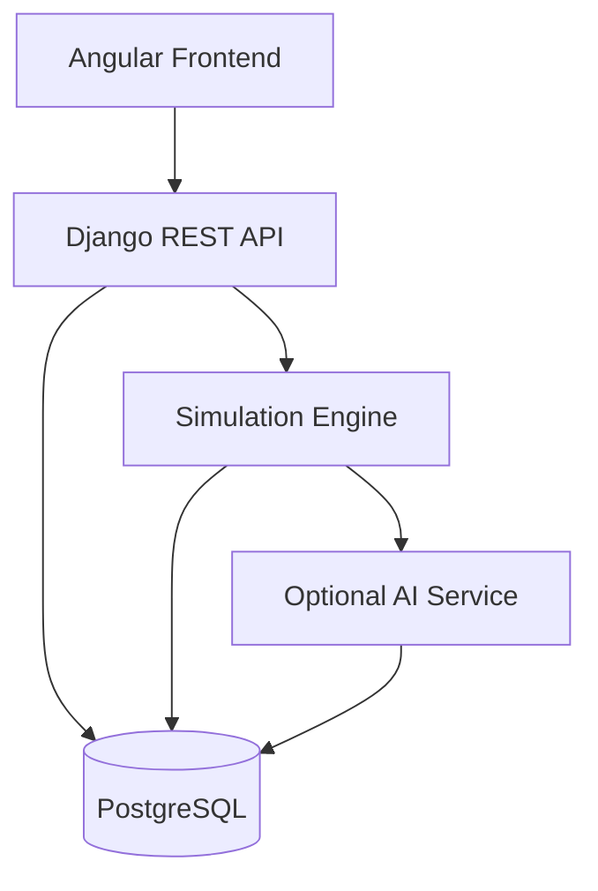
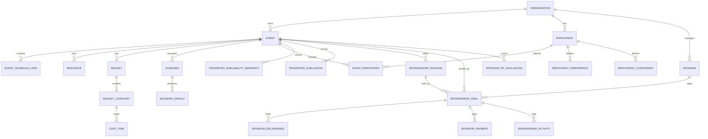

# EventTwin

EventTwin is a digital-twin event planning and decision-support platform for agencies and large project owners.

## Stack

- Backend: Django + Django REST Framework
- Database: PostgreSQL
- Frontend: Angular
- Optional AI layer: Python service or Django-integrated AI module

## Architecture



## Data Model



## Repository structure

```text
backend/
  eventwin_api/
    eventwin_api/
    apps/
    requirements.txt
    manage.py
    .env.example
frontend/
  src/
  angular.json
  package.json
  tsconfig.json
  .editorconfig

docs/
  architecture.md
  sponsors.md
  next-steps.md
database/
  schema/
  migrations/
```

## Local development

1. Create and activate a virtual environment.
2. Install backend dependencies.
3. Configure PostgreSQL and environment variables.
4. Install frontend dependencies.
5. Run Django migrations and the Angular app.

## Docker development

Use Docker after the shared schema is agreed and the first migrations exist, before separate module work starts.

1. Start PostgreSQL and the Django API with `docker compose up --build`.
2. Let the API container run migrations on startup.
3. Keep feature work pointing at the same containerized database so the team shares one runtime.

## Team workflow

- Work on feature branches
- Open pull requests for review
- Keep main stable
- Document shared API and schema changes

## Goal

Provide a working event-management platform with digital-twin simulation, participant management, budget planning, and optional AI assistance.
