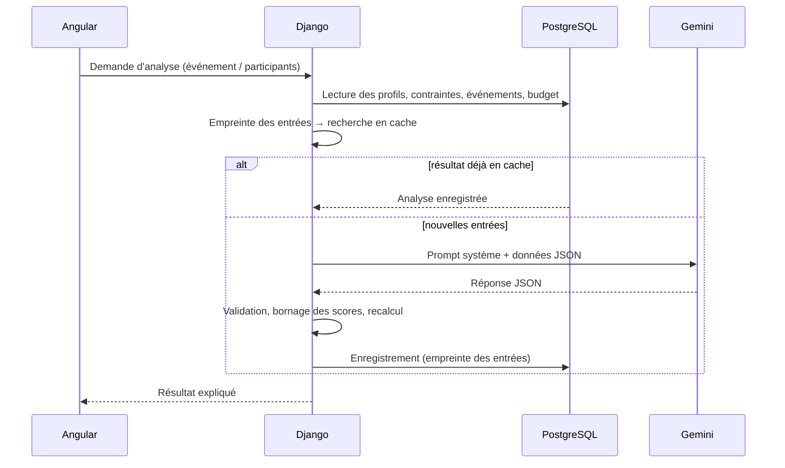

<div align="center">

# 🧠 EventTwin : les prompts utilisés pendant le projet

**Comment nous avons travaillé avec l'IA : les prompts qui ont façonné le produit, et ceux que le produit envoie lui-même à Gemini.**

Mohamed Aziz Maatoug · Chaima Naanaa · Feriel Ammar · Ons Ghariani

</div>

---

## Comment lire ce document

| Partie | Contenu |
|---|---|
| **[Partie 1](#partie-1--prompts-de-développement)** | Les prompts les plus importants donnés à l'assistant de code (Claude Code), dans l'ordre chronologique, regroupés par phase. |
| **[Partie 2](#partie-2--prompts-intégrés-à-lapplication)** | Les prompts **intégrés à EventTwin** et envoyés à Google Gemini pendant l'exécution, avec les techniques de prompt engineering employées. |
| **[Partie 3](#partie-3--ce-que-nous-avons-appris)** | Ce que nous avons appris sur l'art du prompt en chemin. |

> **Source et fidélité.** Les prompts de la partie 1 sont reproduits **mot pour mot**, en anglais et fautes de frappe comprises, depuis les sessions de l'assistant de code du 16 au 19 octobre 2026.
> Les messages purement mécaniques (« continue », logs collés, etc.) sont omis ou résumés. Les seules modifications sont des **masquages** : une clé API et un mot de passe de test, remplacés par `[REDACTED]`.
> Le cahier des charges initial donné à l'agent de code se trouve dans [`EventTwin_Coding_Agent_Spec.md`](../EventTwin_Coding_Agent_Spec.md).

---

## Partie 1 : prompts de développement

### Phase 1 · Intégrer les branches de l'équipe

Chaque membre a développé son module sur une branche séparée. Le premier défi a été de les fusionner sans rien perdre.

> **Prompt 1.1**
> ```text
> the thing is my whole objective is just merging the main and the participant branch is that done
> ```

> **Prompt 1.2 :** repérer une régression due à la fusion
> ```text
> i feel when i was trying to merge with main (and keep evenmenets and the other things that were already in main) i removed them and just replaced evverything with participant
> ```

> **Prompt 1.3 :** réparer l'authentification après la fusion
> ```text
> admin.test@eventwin.local / [REDACTED] doesnt work
> ```

**Notre méthode de débogage :** coller l'erreur brute, telle que sortie de Docker ou du compilateur Angular, sans commentaire, et laisser l'assistant remonter jusqu'à la cause. Par exemple :

> ```text
> Not Found: /api/participants/login/
> [16/Oct/2026 18:55:06] "POST /api/participants/login/ HTTP/1.1" 404 35
> ```
> ```text
> X [ERROR] TS2339: Property 'priced_count' does not exist on type 'AiAnalysis'.
>     src/app/pages/backoffice/budgets/budget-detail.component.ts:780:21
> ```

---

### Phase 2 · Refonte autour du jumeau numérique 3D ⭐

C'est le **prompt le plus structuré du projet** : un cahier des charges complet, rédigé comme une note produit. Il a transformé une application de type tableau de bord en une expérience **centrée sur le jumeau numérique**.
À remarquer : les cas explicites (aucun événement, un seul, plusieurs), les critères d'acceptation, et les règles répétées interdisant d'inventer des données ou de prétendre à une IA qui n'existe pas.

<details>
<summary><b>Prompt 2.1 : « Redesign the Main Experience Around a Predictive 3D Digital Twin »</b> (version intégrale, ~14 000 caractères)</summary>

```markdown
# EventTwin — Redesign the Main Experience Around a Predictive 3D Digital Twin

## Project context

I am building EventTwin, an AI-powered predictive digital twin platform for event organizers.

The goal is to help organizers simulate an event before it happens, understand how its different components interact, identify risks and make better decisions before committing their budget and resources.

The current application already has these sections:

- Supervision
- Événements
- Participants
- Budgets & ressources
- Optimiser
- Équipes & accès
- Mon profil

The current Participants, Budgets & ressources and Supervision screens already have dashboards, KPI cards, tables, charts, alerts and AI-related features. I want to preserve and improve this existing work rather than replace it.

## 1. The main product change

The current dashboard-oriented experience should become a digital-twin-first experience.

When an organizer opens EventTwin, the main content should depend on whether they already have an event configured.

**Case A — An event already exists**

Display the digital twin of the selected event as the primary experience.

The organizer should immediately understand what the event looks like, what its current simulated state is, which aspects require attention and what the AI recommends doing next.

**Case B — No event exists**

Display a polished onboarding and empty state that explains the value of EventTwin and invites the organizer to create their first event.

Provide a clear primary action such as "Créer mon premier événement" and a secondary action explaining how digital twins work.

Do not display an empty, broken or meaningless 3D scene when there is no event.

**Case C — Multiple events exist**

Allow the organizer to select an event, switch between events and create a new one. The home page should show the selected event's digital twin, with its name, date, status and simulation version.

Do not confuse the event-level home page with the existing portfolio-level Supervision page.

## 2. The digital twin must be the centerpiece

The main dashboard should contain a genuine interactive 3D visualization of the event.

The visualization must be generated from the event type, configuration and available data. It must not be a static background image pretending to be a digital twin.

Possible event representations include:

- Conferences and seminars: a 3D venue, rooms, stage, tables, attendees and circulation paths.
- Road trips and group travel: a 3D coach or vehicle, visible passenger seating, passenger assignments, pickup points and the planned route.
- Recruitment fairs and exhibitions: booths, stands, attendee groups and movement between areas.
- Workshops: rooms, capacity, equipment, participant groups and schedules.
- Other event types: an appropriate representation based on the event configuration.

Start by implementing one convincing, functional 3D scene for the event types best supported by the existing application. Do not attempt to build every possible simulation at once.

Inspect the current stack and existing dependencies before choosing a 3D implementation. If the project uses React, consider Three.js with React Three Fiber and Drei. If another framework is already in use, choose an appropriate solution for that stack.

The 3D scene should support, where relevant:

- Orbiting and rotating the camera.
- Zooming and panning.
- Selecting a participant, vehicle, room or resource.
- Highlighting the selected object.
- Displaying contextual information in a side panel.
- Filtering or toggling visualization layers.
- Showing warnings and constraints spatially.
- Switching between useful camera presets.
- Resetting the camera to the default view.

Use realistic proportions, coherent geometry, appropriate materials, shadows and lighting. Aim for a professional digital-twin visualization rather than a cartoon, generic low-quality game environment or flat isometric illustration.

The scene should be visually impressive but also useful for making decisions.

## 3. Participants must exist inside the simulation

Participants should be represented as actual entities associated with the event.

For example, in a coach simulation, participants should have assigned seats where seating information is available. Selecting a passenger should reveal their relevant event information.

For a conference, selecting an attendee could show their registration status, declared preferences, dietary constraints, accessibility requirements when provided, travel constraints and estimated event fit.

The visualization must use the application's actual event and participant data. Do not invent participant assignments, constraints or outcomes and present them as real.

If some data is missing, represent the missing information clearly and let the organizer configure or simulate a proposed assignment.

## 4. Introduce an explainable AI participant-event fit score

Each participant may receive an event-fit score from 0 to 100, provided there is enough relevant data to justify the estimate.

This score should represent how well the planned event matches the participant's declared preferences and practical requirements. It must not represent the participant's personal worth, competence or desirability.

Potential factors include:

- Compatibility with declared event interests and objectives.
- Schedule compatibility and availability.
- Travel feasibility and journey duration.
- Declared dietary requirements and whether catering can accommodate them.
- Accessibility requirements and the availability of appropriate arrangements.
- Accommodation and transport arrangements, when relevant.
- Completion of the participant questionnaire and confidence in the available information.

The weighting must be explicit, configurable where appropriate and consistent with the application's actual data.

For each score, provide:
- The overall score.
- The main factors contributing to it.
- The factors that lower it.
- The missing information affecting confidence.
- Actionable recommendations for improving the planned experience.

Distinguish between a low score caused by missing data and a low score caused by a genuine logistical mismatch.

Never invent model predictions or imply that a real AI model exists if the application currently uses a deterministic calculation or mock data. Clearly distinguish real calculations, simulations, illustrative data and future integrations.

Do not infer sensitive personal characteristics from participant profiles. Use declared, relevant preferences and constraints, and allow organizers to correct data and override proposed arrangements.

## 5. Build a unified event command center

The home page should integrate multiple dimensions of the event instead of presenting unrelated dashboards.

Recommended layout:

### Header

- Selected event name.
- Event date and status.
- Simulation version and last update.
- Event selector.
- Primary action to run or update a simulation.
- Action to create a new event.

### Main area: interactive digital twin

Make the 3D scene the main visual focus.

Provide controls for relevant layers, such as:
- Participants.
- Venue and spaces.
- Transport.
- Resources.
- Risks and alerts.

Only display layers that make sense for the selected event type.

### Supporting KPI cards

Display a concise selection of useful metrics, such as:
- Number of registered participants.
- Participant-data completeness.
- Average estimated event-fit score and confidence.
- Projected budget and committed spending.
- Resource utilization.
- Number of unresolved issues.
- Predicted satisfaction, if the application has a defensible way to estimate it.

Do not display every possible metric at once. Prioritize the information an organizer needs to make decisions.

### AI recommendations and risks

Show the most important issues identified by the simulation.

Each recommendation should explain:
- What the issue is.
- Why it matters.
- Which event components or participants are affected.
- The proposed intervention.
- The expected impact, including uncertainty when applicable.
- How the organizer can inspect, test or accept the proposed change.

### Scenario comparison

Where the underlying functionality supports it, allow organizers to compare a baseline event against an alternative scenario.

Examples:
- Changing the number of shuttle buses.
- Reassigning passengers to seats or vehicles.
- Changing room capacity or room assignments.
- Modifying the schedule.
- Changing resource allocations.
- Adjusting budget assumptions.

Display the resulting differences in relevant metrics and in the 3D scene.

Do not claim that a scenario has been optimized unless an actual calculation or optimization process supports that claim.

## 6. Preserve the existing application and navigation

The existing pages must remain available as detailed workspaces.

- Supervision remains the portfolio-level monitoring dashboard.
- Participants remains the detailed participant-management page.
- Budgets & ressources remains the detailed financial and resource-management page.
- Optimiser remains the scenario-optimization workspace.
- Événements remains the event creation and management workspace.
- Équipes & accès and Mon profil retain their existing roles.

The new event digital twin is the default home experience, not a replacement for these pages.

From the home page, an organizer should be able to navigate directly to the relevant detailed page.

Where possible, carry the selected event into the destination page so the organizer does not have to select it again.

Preserve existing working features, authentication, routing, permissions, data models and business logic. Do not remove existing functionality just to simplify the redesign.

## 7. Empty state and event creation flow

If the organizer has no event, display an intentional, premium empty state.

Explain that EventTwin creates a predictive representation of an event to help simulate its organization before the actual date.

The primary call to action should launch the existing event-creation flow, if available.

If that flow does not exist, build a minimal but functional creation flow that collects essential information such as:

- Event name.
- Event type.
- Event date.
- Location or route, depending on the event type.
- Expected participant count.
- Initial budget, if relevant.

Use this information to initialize an event and its corresponding digital twin.

After creation, navigate to the new event's digital-twin home page.

Validate required fields, handle loading and error states, and persist the event using the existing backend and data model. Do not create a fake success state that disappears on refresh.

## 8. Visual direction

Preserve the existing EventTwin identity and overall visual language.

The current application uses:
- A white and very light blue background.
- Dark navy typography.
- Violet-to-cyan accents.
- Rounded cards.
- Subtle borders and shadows.
- A persistent left sidebar.
- A clean enterprise SaaS layout.

Keep these recognizable elements, but elevate the main experience to feel like a professional simulation and operations platform.

The 3D environment should have enough space to be the visual centerpiece. Avoid filling the entire screen with small KPI cards and tables.

Use clear hierarchy, restrained gradients, good typography, meaningful whitespace and accessible contrast.

The result should feel like an enterprise digital-twin product with a strong 3D simulation layer, not just another generic analytics dashboard.

## 9. Implementation requirements

Before coding:

1. Inspect the repository, framework, routing, current components, styles, dependencies and backend integration.
2. Identify the existing event, participant, budget and resource data models.
3. Identify which features are functional, which use mock data and which are incomplete.
4. Determine the smallest architectural changes needed to implement the new home experience.
5. Reuse existing components and logic wherever sensible.

Then implement the redesign in the actual codebase.

Do not respond with only a plan, wireframe or code snippets. Make the changes directly in the project.

Prioritize the following order:

1. Implement the new event-aware home page and its empty state.
2. Build one genuinely interactive 3D digital-twin scene.
3. Connect the scene to available event and participant data.
4. Add contextual selection and event-level KPI summaries.
5. Integrate the highest-priority AI recommendations and risks.
6. Preserve and connect the existing detailed pages.
7. Add scenario controls where the current architecture supports them.
8. Test navigation, persistence, responsiveness, loading states and error handling.

If a complete AI or optimization backend is not yet available, build the UI against a clearly separated service interface with deterministic, transparent demo calculations where necessary. Do not fabricate real-world predictions.

Avoid unnecessary dependencies and major rewrites. Do not break existing functionality to achieve the new visual design.

## 10. Acceptance criteria

The implementation is successful when:

- Opening EventTwin with an existing event displays that event's digital twin as the main experience.
- Opening EventTwin without an event displays a useful creation-oriented empty state.
- Creating an event leads to its corresponding digital-twin view.
- The 3D scene is interactive and responds to actual event data.
- Relevant participants and resources can be selected inside the scene.
- Participant fit scores, if present, are explainable and distinguish missing data from actual incompatibilities.
- The organizer can identify the most important risks and navigate to their detailed management pages.
- Existing dashboard pages remain available and functional.
- The selected event remains consistent across navigation.
- The interface remains usable on different screen sizes.
- The project builds successfully without introducing avoidable runtime errors.
- Demo data, real data, predictions and unimplemented integrations are clearly distinguished.

Start by inspecting the repository and then implement the best end-to-end version possible with the existing architecture. Make reasonable decisions autonomously, and report what you changed, what works, and what remains dependent on backend or AI integration.
```

</details>

---

### Phase 3 · Préparer la soutenance

> **Prompt 3.1**
> ```text
> can you generate all the possible Q&A questions we could get asked by our prof on this project
>  (leave a small part for business questions but then keep the rest for mostly technical questions including prompt engineering questions, generate a full list in a .md file
> ```

> **Prompt 3.2 :** adapter au public visé
> ```text
> i think he wont be asking very in detail technical question mostly questions about the general architecture and where ai fits and which inputs the ai takes and which is returned at which point etc or maybe about optimization and database, he wont be asking about specific functions, adapt this while also reminding in the top of the document about the general architecture of this project, database wise and also ai wise where it fits
> ```

---

### Phase 4 · Intégrer Gemini et des données réalistes ⭐

> **Prompt 4.1 :** changer de fournisseur d'IA (Ollama en local → Gemini)
> ```text
> replace the llm from ollama with this api key in gemini: [REDACTED]
> ```
> *Leçon retenue : ne jamais mettre une clé dans un prompt ni dans le code. Elle se trouve désormais uniquement dans `backend/eventwin_api/.env`, ignoré par Git.*

> **Prompt 4.2 :** données de démo + score d'adéquation IA
> ```text
> i want to inject in the database a bunch of particpants and events that are prefilled, besides that i want to work on the ai feature that uses the participant profiles to see how adapted they are to events using the gemini api, it will need to be clear between eventds how thre would be a difference between events for specific particpants
> ```
> *Résultat : la commande `seed_demo` (12 profils volontairement contrastés × 6 événements) et l'analyse comparative d'adéquation par Gemini (voir la [partie 2](#21--adéquation-participant--événement-appsaifitpy)).*

> **Prompt 4.3 :** supprimer les scores codés en dur
> ```text
> besides the hardcoded scores for the participants i want the gemini api to be integrated within it, also the gemini api isnt really working in the budget part + what is a proper scenario to showcase this project from start to finish
> ```

---

### Phase 5 · UX, données réelles et design

> **Prompt 5.1**
> ```text
> for the participants in the display in the participant interface can you show the real ones in the database, and check the entire project for hardcoded stuff and remove it, and also make the design more ui ux friendly and make the project open on the 3d digital twin and make the interface better and more friendly and pleasing, add text font that is business and aestehtic and make it pleasing
> ```

> **Prompts 5.2 et 5.3 :** l'assistant 3D du budget
> ```text
> normally therer should be a 3d assistant in the budget area where has that gone
> ```
> ```text
> fix that page with the 3d assistant make it adapted to the design and remove any issues in it: Malvoyante : accompagnement et supports adaptés (gros caractères, audio) · 1
> ```

---

### Phase 6 · Module sponsors

> **Prompts 6.1 et 6.2**
> ```text
> is there a table sponsors in this and what is it tied to?
> ```
> ```text
> i will create anew branch and then merge it there what's in prod with the sponsor branch and make sure sponsors show up in the solution but stilll have everything make sense
> ```

---

### Phase 7 · Expérience participant

> **Prompt 7.1**
> ```text
> for participants make the evenements interface more interactive and better looking because for them it's not a dashboard like the admins, and add the ability for participants to join specific events that are availble
> ```
> *Résultat : une page dédiée aux participants (cartes d'événements, filtres, panneau de détail, inscription et désinscription en un clic), avec des contrôles côté serveur sur la publication, la capacité, les doublons et les événements passés.*

> **Prompt 7.2 :** vérifier la cohérence entre les modules
> ```text
> would a participant who willingly joins an event show up in the digital twin of that event in the admin section
> ```

---

### Phase 8 · Livraison

> **Prompt 8.1**
> ```text
> okay the prof wants an easy way to boot this project up after he pulls it from the github, or rather after he gets the repository, does the readme contain enough instructions to do the docker containers, and also about the account admin login etc, is there a way to make it easier for him to access directly without changing the code of the repo but trhough giving him pecific commands to execute to maybe inject the database or something like that, i need it to be as easy as possible to try this project on his pc aside from the containers of docker can you brainstorm with me and execute in the readme, also aliment a document with the most prominent prompts that i've used throughout this project, so that he could see them since he asked for it, (so create the new document, and update the readme with the new info, make it styish, make it have our names Mohamed Aziz Maatoug, Chaima Naanaa, Ons Ghariani, Feriel Ammar, and do all the stuff i told you to do)
> ```
> *Résultat : le [démarrage rapide](../README.md#-démarrage-rapide--5-minutes) du README, l'instantané de démo `fixtures/demo_snapshot.json` (avec les analyses IA en cache) et ce document.*

---

## Partie 2 : prompts intégrés à l'application

EventTwin appelle **Google Gemini** à deux endroits. Dans les deux cas, le backend construit le prompt à partir des **données de la base**, exige une réponse en **JSON strict**, puis **valide et recalcule** le résultat avant de l'afficher.



### 2.1 · Adéquation participant ↔ événement (`apps/ai/fit.py`)

**Entrée :** le profil d'un participant (préférences et contraintes déclarées) et la description de **plusieurs** événements.
**Sortie :** un score de 0 à 100 par dimension et par événement, les contraintes bloquantes, les points forts, les risques, les aménagements, et une comparaison entre les événements.

```text
Tu es un expert en organisation d'événements et en inclusion.
Tu évalues à quel point UN participant est adapté à PLUSIEURS événements, en
comparant les événements entre eux pour ce participant précis.

Règles :
- Base-toi uniquement sur le profil et les descriptions fournis ; n'invente
  aucun fait sur l'événement.
- Note chaque dimension de 0 (incompatible) à 100 (idéal). Mets null si le
  profil ne contient aucune information sur cette dimension.
- Dimensions : <8 dimensions pondérées : accessibilité, alimentation, mobilité & transport, budget, rythme & disponibilités, intérêts & objectifs, ambiance, langue>
- "blockers" : uniquement les contraintes marquées STRICTE que l'événement, tel
  que décrit, ne peut pas satisfaire sans changement majeur. Liste vide sinon.
- Sois concret et différenciant : explique ce qui change d'un événement à
  l'autre pour CE participant, en citant des éléments précis (horaires,
  menu, effort, hébergement, langue…).
- Dans tous les textes, désigne les événements par leur NOM, jamais par
  leur référence technique (E1, E2…).
- Rédige en français, phrases courtes.

Réponds UNIQUEMENT avec un objet JSON de la forme :
{ "events": [ { "event_ref", "dimensions": {"<dimension>": {"score", "note"}},
               "blockers", "strengths", "risks", "adaptations", "summary" } ],
  "comparison": "2 à 4 phrases : quel événement convient le mieux…" }
```

### 2.2 · Analyse budgétaire (`apps/budgets/ai_analysis.py`)

**Entrée :** l'événement, ses postes budgétaires (quantité, quantité minimale, essentiel ou non, prix unitaire vérifié), le total calculé et le budget maximal.
**Sortie :** une synthèse, une recommandation principale, des scénarios d'optimisation qui portent sur des postes existants, et des recommandations.

```text
Tu es un consultant expert en organisation d'événements.
Tu réponds UNIQUEMENT en JSON valide, sans texte autour, sans commentaire.
Tu parles français. Tu respectes strictement le schéma demandé.
Tu ne calcules jamais les totaux toi-même : ils te sont fournis et tu les réutilises.
Le statut et le mode transmis par l'application sont définitifs : tu ne dois
jamais les contredire. Tu ne dois jamais inventer un prix, une économie, une
offre, un fournisseur, une URL ou une disponibilité.
```

S'y ajoutent des instructions propres à chaque mode, par exemple lorsque le budget est dépassé :

```text
Le budget est DÉPASSÉ. Ton objectif : ramener le coût total sous le budget
maximal **sans supprimer aucune ressource** et **sans descendre un poste sous
sa quantité minimale** (donnée dans la liste). Commence par les postes
« essentiel=non » les plus coûteux.
```

### 2.3 · Techniques de prompt engineering employées

| Technique | Pourquoi |
|---|---|
| **Rôle + règles explicites** dans un *prompt système* séparé des données | Comportement stable d'un appel à l'autre |
| **Schéma JSON strict** dans le prompt + analyse côté serveur | Une sortie directement exploitable, sans analyse de texte fragile |
| **`null` = aucune information** (plutôt qu'un score moyen) | Distingue *donnée manquante* et *réelle incompatibilité* |
| **Notation comparative** (un participant × plusieurs événements en un seul appel) | Des scores nettement différenciés entre événements, et une comparaison expliquée |
| **« Ne jamais inventer »** (prix, fournisseurs, URL, faits) | Moins d'hallucinations ; ce qui ne peut pas être vérifié est signalé comme estimation |
| **Totaux fournis, jamais calculés par le modèle** | Les LLM calculent mal : le backend recalcule tout |
| **Statut décidé par l'application** (budget dépassé ou non) | Le modèle ne peut pas contredire la logique métier |
| **Noms d'événements plutôt qu'identifiants techniques** | Des explications lisibles par un humain |
| **Bornage et validation des scores** après la réponse | Les scores hors limites ou mal formés sont corrigés ou rejetés |
| **Cache indexé par une empreinte des entrées** | Économise le quota ; résultats identiques pour des entrées identiques |
| **Chaîne de modèles de repli** (`GEMINI_FALLBACK_MODELS`) | Le service continue quand le modèle principal est saturé ou à court de quota |

---

## Partie 3 : ce que nous avons appris

1. **Un long prompt structuré vaut mieux que dix prompts courts** pour une refonte majeure : contexte, cas explicites, priorités, critères d'acceptation (prompt 2.1).
2. **Exiger explicitement l'honnêteté** (« ne rien fabriquer », « distinguer réel / simulé / manquant ») a façonné tout le produit, pas seulement les réponses de l'IA.
3. **Les prompts de relance courts** fonctionnent bien pour itérer (« un participant apparaîtrait-il dans le jumeau numérique ? ») : ils font ressortir les incohérences entre modules.
4. **Coller l'erreur brute** est le moyen le plus rapide de déboguer.
5. **Les secrets ne vont jamais dans un prompt** : une clé API partagée par erreur doit être révoquée puis déplacée dans un `.env` ignoré par Git.
