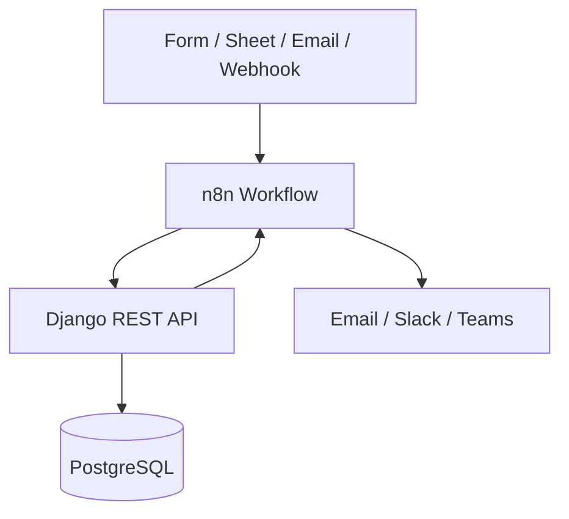

# n8n Integration For EventTwin

## What n8n is for here

n8n is best used as an automation and integration layer around EventTwin, not as the core business system.

It fits best when the app needs to:

- move data between EventTwin and external tools
- run repetitive workflows on a schedule or webhook
- send notifications or create follow-up tasks
- import or export data from spreadsheets, forms, email, or chat tools

## Best module fit

The module that benefits most from n8n is **Participants & Preferences**.

Why it fits best:

- participant import is repetitive
- questionnaires can come from forms or external systems
- preference and constraint data often arrives from multiple sources
- follow-up messages can be automated after import or update

Other modules can also benefit:

- **Event & Organization**: create events from a form, sync calendars, notify organizers
- **Budget, Resources & Optimization**: alert when budget limits are reached, send approval requests
- **Digital Twin, Simulation & AI**: trigger simulation runs after scenario updates, publish result summaries

## Recommended order

If you only automate one part first, start with:

1. Participant import and cleanup
2. Questionnaire or preference collection
3. Budget alerts and approval flow
4. Scenario result notifications

That gives the team the quickest value without changing the core application logic.

## How it works

n8n should sit beside EventTwin and call the Django REST API when something happens.

### Typical flow

1. A form, spreadsheet, or webhook starts the workflow.
2. n8n cleans or maps the data.
3. n8n sends the data to a Django API endpoint.
4. Django validates and stores it in PostgreSQL.
5. n8n sends a confirmation, alert, or follow-up message.

## Example use cases

### Participant import

- Source: CSV, Excel, Typeform, Google Forms
- n8n task: transform rows into the EventTwin participant format
- Django target: participant and preference endpoints
- Result: fewer manual imports and cleaner participant data

### Budget alert

- Source: scheduled check or budget update
- n8n task: compare planned amount and actual amount
- Django target: budget and cost item endpoints
- Result: automatic warning when a budget threshold is crossed

### Scenario notification

- Source: scenario result creation
- n8n task: summarize the scenario output and notify the team
- Django target: scenario result endpoint
- Result: faster review of simulation outcomes

## Good rule of thumb

Use n8n when the work is integration, automation, or notification.

Keep Django responsible for:

- validation
- business rules
- database writes
- access control

That keeps the architecture simple and avoids spreading the core logic across workflows.