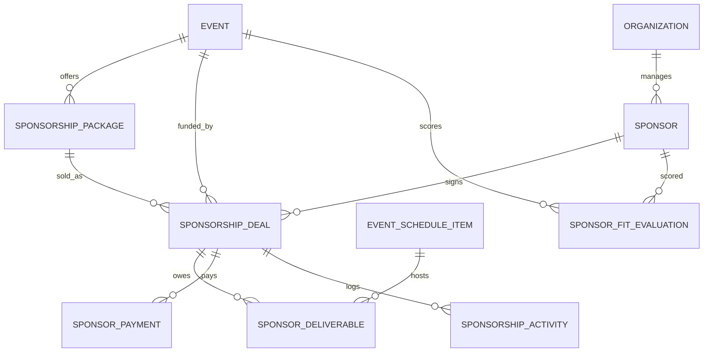
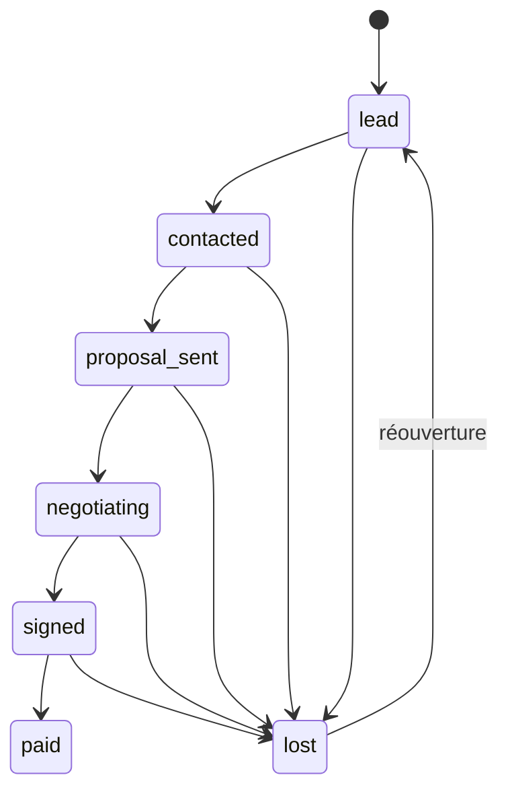

# Module Sponsors

Le module **sponsors** ajoute les entrées d'argent au projet : un sponsor finance un événement (cash ou en nature) en échange de contreparties de visibilité.

## Règle métier

Les sponsors n'ont **pas de compte**. Ils sont créés et gérés uniquement par un organisateur (`Participant.role = organizer`) ou un administrateur (`role = admin`). Un sponsor accède à son dossier uniquement via un **lien de portail signé** généré par l'organisateur.

## Sécurité

Le module utilise l'**authentification du projet** (jeton DRF envoyé par l'intercepteur Angular) et les règles de `apps/core/permissions.py` :

- `get_acting_participant(request)` renvoie le profil `Participant` de l'utilisateur **authentifié** — ou, pour un super-administrateur Django sans profil, un `SuperAdminActor` (voit tout, n'est jamais enregistré comme auteur ou responsable : `as_participant()` le convertit en `None`).
- `IsOrganizerOrAdmin` : organisateur **actif** (`Participant.is_organizer`) ou super-administrateur.
- `OrganizationScopedMixin` filtre sur l'organisation de l'organisateur ; un super-administrateur voit tout.
- `scoped_event_or_error` / `scoped_scenario_or_error` appliquent le même cloisonnement aux endpoints d'analyse (un événement d'une autre organisation répond 404).
- Anonyme : 401 (le front redirige vers la connexion). L'ancien en-tête `X-Participant-Id`, falsifiable, **n'est plus lu** (test `test_legacy_participant_header_is_ignored`).

Le portail sponsor reste public : accès par jeton signé uniquement.

## Modèles

| Modèle | Rôle |
| --- | --- |
| `Sponsor` | Fiche CRM. `organization` et `created_by` sont posés par le serveur. Unicité `(organization, name)`. |
| `SponsorshipPackage` | Offre par événement (prix, places, exclusivité sectorielle, poids de visibilité, contreparties types). |
| `SponsorshipDeal` | Accord sponsor ↔ événement, avec pipeline, montants, probabilité, responsable (`owner`). Unicité `(event, sponsor)`. |
| `SponsorshipActivity` | Journal en ajout seul (qui, quoi, quand). |
| `SponsorDeliverable` | Contrepartie promise, liée optionnellement à un `EventScheduleItem` et à une `Resource`. |
| `SponsorPayment` | Échéancier de paiement. |
| `SponsorFitEvaluation` | Score de pertinence explicable (`breakdown` détaille chaque critère). |



## Machine à états d'un deal



- Le statut ne change **que** via `POST /api/sponsorship-deals/{id}/transition/` : un `PATCH` du statut est refusé (400).
- `lost` exige un motif (`lost_reason`).
- Chaque transition écrit une entrée dans le journal et applique la probabilité par défaut du nouveau statut (sauf si `probability_percent` est fourni).
- **À la signature** : `signed_at` est posé, les contreparties du package sont générées, et l'échéancier par défaut est créé (30 % à la signature, 70 % 30 jours avant l'événement, jamais avant la date de signature). La génération est **idempotente**.
- La signature est **refusée** si elle créerait un conflit bloquant (`slots_exceeded`, `industry_exclusivity` confirmé, `resource_overbooked`) impliquant ce deal.

## Endpoints

Tous protégés par `IsOrganizerOrAdmin` et cloisonnés par organisation, sauf le portail. Les listes acceptent `?event=<uuid>`.

### CRUD

`/api/sponsors/`, `/api/sponsorship-packages/`, `/api/sponsorship-deals/` (`?mine=1` : mes dossiers), `/api/sponsorship-activities/` (GET, POST ; filtre `?deal=`), `/api/sponsor-deliverables/`, `/api/sponsor-payments/`, `/api/sponsor-fit-evaluations/`.

- `POST /api/sponsors/` répond **409** `{duplicates: [...]}` si un sponsor similaire existe (nom normalisé sans accents ni suffixe juridique, ou même domaine web). Renvoyer avec `?force=true` pour créer quand même.
- Supprimer un package qui a des deals signés répond 400.

### Actions

| Méthode | URL | Description |
| --- | --- | --- |
| POST | `/api/sponsorship-deals/{id}/transition/` | `{status, probability_percent?, lost_reason?}` |
| POST | `/api/sponsorship-deals/{id}/assign/` | `{owner}` : admin ou responsable actuel ; le nouveau responsable doit être un organisateur de la même organisation |
| POST | `/api/sponsorship-deals/{id}/portal-link/` | `{send_email?, to_email?}` : deal signé ou payé uniquement |
| GET | `/api/sponsorship-deals/{id}/report/` | Livré vs promis, paiements, exposition estimée |
| GET | `/api/sponsorship-deals/{id}/report-csv/` | Même rapport en CSV |
| POST | `/api/sponsors/quick-create/` | `{sponsor, deal?}` en une transaction (rollback si le deal est invalide) |
| POST | `/api/sponsors/import/` | CSV (`file` multipart ou `csv` texte) |
| GET | `/api/sponsorship-summary/?event=` | synthèse + conflits + alertes |
| GET | `/api/sponsorship-recommendations/?event=&gap=` | combinaisons de packages |
| GET | `/api/sponsorship-conflicts/?event=` | conflits |
| GET | `/api/sponsorship-alerts/?event=` | alertes |
| POST | `/api/sponsor-fit/evaluate/` | `{event, sponsor_ids?}` → liste triée par score |
| GET | `/api/sponsorship-net-budget/?event=&budget=` | budget net (lecture seule) |
| GET | `/api/sponsorship-scenario-impact/?scenario=&include_weighted=` | revenu pour un scénario (lecture seule) |

> Le rapport CSV est exposé sur `report-csv/` (et non `report.csv`) : le `DefaultRouter` de DRF interprète `.csv` comme un suffixe de format et ne route pas l'action.

Exemple de transition :

```json
POST /api/sponsorship-deals/7f1c.../transition/
{ "status": "lost", "lost_reason": "Budget gelé" }
```

Réponse d'erreur (400) :

```json
{ "detail": "Transition impossible : lead → paid.", "conflicts": [] }
```

Exemple de recommandation :

```json
{
  "gap": 12000.0,
  "proposals": [{
    "items": [
      { "package_name": "Or", "price": 8000.0, "quantity": 1, "subtotal": 8000.0 },
      { "package_name": "Argent", "price": 4000.0, "quantity": 1, "subtotal": 4000.0 }
    ],
    "packages_count": 2, "total": 12000.0, "surplus": 0.0, "shortfall": 0.0, "covers_gap": true
  }]
}
```

## Règles de calcul

- **Pipeline** : confirmé = deals `signed` + `paid` ; pondéré = somme `cash × probabilité` des deals ouverts ; écart = `max(target_budget − confirmé, 0)`.
- **Recommandation** : combinaison de packages actifs (places restantes = `slots_total` − deals confirmés) qui couvre l'écart avec le moins de packages, puis le plus petit surplus. Si impossible, meilleure couverture partielle.
- **Pertinence** (0-100, poids configurables dans `services.DEFAULT_FIT_WEIGHTS`) : secteur vs type d'événement, taille/nature de l'audience, budget cohérent avec les packages, historique de partenariats, audience concernée (participants dont une préférence correspond au secteur). `estimated_roi` est un **revenu attendu pondéré** (prix de référence × score).
- **Conflits** : `slots_exceeded` (erreur), `slots_overpromised` (alerte), `industry_exclusivity`, `competing_sponsors`, `resource_overbooked`.
- **Exposition** : `participants attendus × somme des poids des contreparties livrées × visibilité du package`.
- **Alertes** : paiements en retard ou dus sous 7 jours, contreparties en retard ou à risque, négociations sans activité depuis 14 jours, conflits.

## Points d'extension pour les autres modules (rien n'est écrit chez eux)

### Budget

`net_budget(event)` s'appuie sur le module Budget actuel : coût estimé = ressources `BudgetItem` chiffrées, via le même `calculate_budget` que la page Budget ; budget cible = `Event.target_budget`. Le paramètre `?budget=` est accepté pour compatibilité mais sans effet (un événement a un seul budget).

Intégrations dans l'application :

- **Page Budget** (`/app/budgets/:id`) : carte « Financement sponsors » — confirmé, pipeline pondéré, coût estimé et **coût net à financer** (coût estimé − sponsoring confirmé), rafraîchie après chaque analyse IA.
- **Supervision** (`/api/dashboard/`) : colonne Sponsoring (confirmé, pondéré, coût net) par événement, total couvert par les sponsors, et alertes sponsors (paiements, contreparties, négociations inactives, conflits) dans « Points d'attention ».

### Simulation

`services.sponsorship_impact_for_scenario(scenario, include_weighted=False)` retourne `{confirmed_cash, weighted_pipeline, total_revenue, ...}`. La personne en charge de la simulation peut l'appeler dans le calcul d'un `ScenarioResult` pour afficher un coût net. Le module n'écrit rien dans `simulation`.

## Portail sponsor

- `POST .../portal-link/` génère un jeton `django.core.signing` (sel `sponsors.portal`, durée `SPONSORS_PORTAL_TTL_DAYS`, 30 par défaut) et peut l'envoyer par e-mail (`templates/emails/sponsor_portal_invite.html`). Sans SMTP configuré, l'e-mail s'affiche dans la console.
- `GET /api/sponsor-portal/{token}/` (public, limité à 60 requêtes/min par IP) ne renvoie que : événement, sponsor, package, contreparties, paiements. Jamais de notes, probabilité, responsable, journal, ni autres sponsors.
- `POST /api/sponsor-portal/{token}/deliverables/{id}/submit-asset/` `{asset_url}` : URL `http(s)` uniquement, contrepartie du deal du jeton uniquement, statut → `in_progress`.
- Jeton invalide ou dossier perdu : 404 ; jeton expiré : 410.

## Variables d'environnement

| Variable | Défaut | Rôle |
| --- | --- | --- |
| `SPONSORS_AI_ENABLED` | `false` | Réservé aux fonctions IA optionnelles (aucune n'est requise) |
| `SPONSORS_WEBHOOK_URL` | vide | Webhook (n8n) pour `send_sponsor_alerts` ; sans valeur : log seulement |
| `SPONSORS_PORTAL_TTL_DAYS` | `30` | Durée de validité du lien portail |
| `SPONSORS_PORTAL_BASE_URL` | `http://localhost:4200` | Base des liens de portail |

## Commandes de gestion

```bash
python manage.py refresh_sponsor_payments   # paiements échus -> overdue
python manage.py send_sponsor_alerts        # POST JSON vers SPONSORS_WEBHOOK_URL (compatible n8n)
python manage.py seed_sponsors              # démo idempotente : 8 sponsors, 3 packages, 6 deals
```

Charge utile du webhook : `{ "source": "eventtwin-sponsors", "generated_at": "...", "events": [{ "event_id", "event_name", "alerts": [...] }] }`. Rien n'est envoyé s'il n'y a aucune alerte.

## Frontend

Routes sous `/app/sponsors` (garde `organizerGuard` : organisateur ou admin) : `overview`, `pipeline` (Kanban glisser-déposer), `directory`, `packages`, `deliverables`, `payments`, `analysis`. Panneaux partagés : détail d'un deal (résumé, contreparties, paiements, historique) et formulaire sponsor (création rapide, doublons). Page publique du portail : `/sponsor/:token`.

Chaque écran gère les états chargement, vide et erreur (avec « Réessayer »). Une erreur 403 affiche « Accès réservé aux organisateurs ».

## Tests

```bash
docker compose exec api python -m pytest apps/sponsors -q   # base de test PostgreSQL séparée (test_eventwin)
docker compose exec api python manage.py test apps          # reste du projet
cd frontend && npx ng build --configuration development
```

`pytest.ini` utilise `eventwin_api.settings` : ne pas le faire pointer sur `test_settings`, dont la base de test est la base réelle (usage `--keepdb` avec le runner Django uniquement).

## Limites connues

- `GET /api/participants/get_organizers/` (module participants) renvoie les organisateurs de toutes les organisations : le panneau de deal filtre côté client par organisation.
- Un deal peut être **créé** directement avec un statut avancé (utile pour l'import et les tests) ; les contreparties ne sont alors générées qu'en passant par `transition`.
- La démonstration (`seed_demo`) appelle `seed_sponsors` sur le « Sommet IA & Data Paris » de l'organisation de démo.
